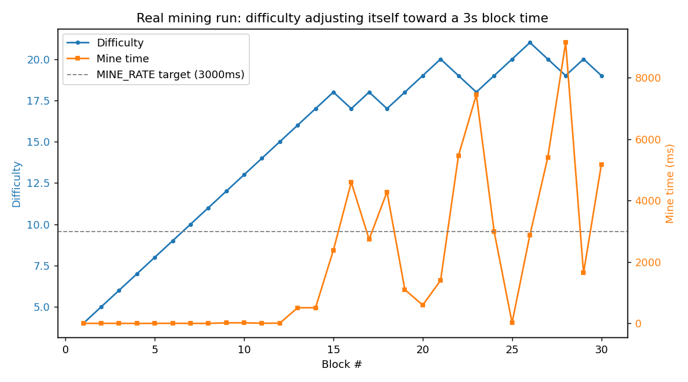

# Blockchain Project 1

A from-scratch blockchain and cryptocurrency in Node.js: proof-of-work mining
with self-adjusting difficulty, ECDSA-signed wallet transactions, a
transaction pool, and peer-to-peer chain/transaction sync over WebSockets.
No blockchain libraries - the hashing, signing, mining loop, consensus rule
(longest valid chain) and P2P layer are all implemented directly.

## How it fits together

```
Wallet --sign--> Transaction --> TransactionPool --> Miner --mines--> Block --> Blockchain
   |                                    ^                  |                        |
   |                                    |                  +---- P2pServer <--------+
   +------------------- Express API (app/index.js) ------------------+
```

- **`chain-util.js`** - ECDSA keypairs (secp256k1) and signature verification.
- **`crypto-hash.js`** - SHA-256 hashing and the leading-zeros difficulty check.
- **`blockchain/block.js`** - a block, proof-of-work mining, and difficulty
  adjustment targeting `MINE_RATE` (3s).
- **`blockchain/index.js`** - the chain itself: adding blocks, validating an
  entire chain (hashes, proof-of-work, difficulty deltas, transaction data),
  and replacing the local chain with a longer valid one from a peer.
- **`wallet/`** - a wallet (keypair + balance), signed transactions, and a
  pool of pending transactions.
- **`app/miner.js`** - pulls valid transactions from the pool, adds a reward
  transaction, mines a block, and clears the pool across every peer.
- **`app/p2p-server.js`** - WebSocket layer: syncs the chain and the
  transaction pool across every connected peer.
- **`app/index.js`** - the Express REST API tying all of the above together.

## Install

```bash
npm install
```

## Run

```bash
npm start                 # single node on HTTP_PORT=3001, P2P_PORT=5001
npm test                  # jest - 19 tests across block/chain/transaction
```

To run multiple nodes on one machine, give each one its own ports and point
it at its peers:

```bash
HTTP_PORT=3001 P2P_PORT=5001 npm start
HTTP_PORT=3002 P2P_PORT=5002 PEERS=ws://localhost:5001 npm start
HTTP_PORT=3003 P2P_PORT=5003 PEERS=ws://localhost:5001,ws://localhost:5002 npm start
```

## API

| Method | Route | Body | What it does |
|---|---|---|---|
| GET | `/blocks` | - | The full chain |
| GET | `/transactions` | - | Pending transactions in this node's pool |
| GET | `/public-key` | - | This node's wallet address |
| GET | `/wallet-info` | - | This node's wallet address and current balance |
| POST | `/transact` | `{ recipient, amount }` | Sign and broadcast a transaction |
| POST | `/mine-transactions` | - | Mine a block from the pool (+ reward), sync it to every peer |
| POST | `/mine` | `{ data }` | Mine a block of arbitrary raw data, bypassing the wallet/pool system - for quick manual testing |

## A real two-node run

Two nodes, started with nothing shared but a WebSocket peer link
(`PEERS=ws://localhost:5401` on node B pointing at node A). Everything below
is copy-pasted from an actual run, not written by hand - addresses/hashes are
truncated for readability, nothing else is edited.

```
$ curl -s http://localhost:3401/public-key
{
    "publicKey": "04c95b3ea75a56ca7bb3ddb835a83ceaba64c89808aac8ab5ac39a317d29a94cc35742a263af07242f1a05d98c74c99c06e799b899c0ca5f3eaf8baa676379d80a"
}

$ curl -s -X POST http://localhost:3401/transact \
    -d '{"recipient":"bob-address","amount":75}'
{
    "id": "c4338120-cae4-11f1-bdcb-59054b6239e0",
    "input": {
        "timestamp": 1792321931826,
        "amount": 500,
        "address": "04c95b3ea75a56ca7bb3ddb835a83ceaba64c89808aac8ab5ac39a317d29a94cc35742a263af07242f1a05d98c74c99c06e799b899c0ca5f3eaf8baa676379d80a",
        "signature": "3046022100b82bef8fb3e8fa898d1190b691743b756d26280b046cbb7842d5fd8fd290991d..."
    },
    "outputs": [
        { "amount": 425, "address": "04c95b3ea75a56ca7bb3ddb835a83ceaba64c89808aac8ab5ac39a317d29a94cc35742a263af07242f1a05d98c74c99c06e799b899c0ca5f3eaf8baa676379d80a" },
        { "amount": 75,  "address": "bob-address" }
    ]
}

$ curl -s -X POST http://localhost:3401/mine-transactions
HTTP 302 (redirects to /blocks)

$ curl -s http://localhost:3401/blocks        # node A - just mined
Chain length: 2
Last block hash: 0c0906249f93c88d...

$ curl -s http://localhost:3402/blocks        # node B - never called directly,
Chain length: 2                               # only ever talked to node A's
Last block hash: 0c0906249f93c88d...           # WebSocket peer link

$ diff <(curl -s http://localhost:3401/blocks) <(curl -s http://localhost:3402/blocks)
node A and node B chains are byte-identical
```

Node B's chain updated itself the moment node A mined - nobody told node B
anything directly, it just reacted to a `CHAIN` message over the socket,
validated the whole incoming chain (hashes, proof-of-work, difficulty deltas,
every transaction's signature and claimed balance), and adopted it because it
was longer and valid. That's `blockchain/index.js#replaceChain` and
`app/p2p-server.js` actually doing consensus, not two processes that happen
to agree.

## Proof-of-work actually self-adjusting

`Block.adjustDifficulty` nudges difficulty up or down by 1 after every block,
trying to keep mine time near `MINE_RATE` (3s). This is a real mining run -
30 blocks mined back to back with no artificial delay, via
`scripts/measure-difficulty.js`:



Difficulty climbs fast for the first ~10 blocks because SHA-256 is fast and
mine time is sub-millisecond at low difficulty - there's no downward pressure
yet. Once mine time starts actually approaching 3s (around block 15), the
single-block reactive adjustment starts visibly oscillating around the
target instead of converging smoothly, which is exactly what you'd expect
from a ±1-per-block controller reacting to one noisy sample at a time rather
than an average. Regenerate it yourself:

```bash
node scripts/measure-difficulty.js 30
python scripts/plot-difficulty.py     # needs: pip install matplotlib
```

## Limitations

- `crypto-js` (used for `Block.hash`) is deprecated upstream; `crypto-hash.js`
  already uses Node's native `crypto` module for everything else and would be
  the natural target to consolidate onto.
- The P2P layer connects directly to every address in `PEERS` - there's no
  peer discovery or gossip relay, so every node needs every other node's
  address up front.
- No persistence - each node's chain lives in memory and is gone on restart.

## License

MIT - see [LICENSE](LICENSE).
